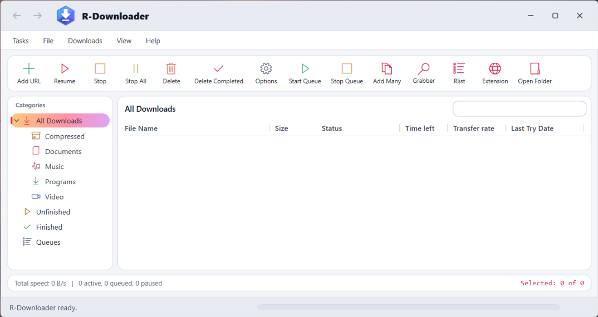

<div align="center">


# ROCK TOOLBOX

### One native Windows toolbox to **install, tune, clean, repair and update** everything.

Native C# app: no PowerShell needed to run it. 435 apps, 12 languages, one clean window.

<br>

[](https://github.com/OwnerRock/RockToolbox/releases)
[](#requirements)
[](#requirements)
[](#project-structure)
[](#languages)
[](#license)

[](https://github.com/OwnerRock/RockToolbox/releases)
[](https://github.com/OwnerRock/RockToolbox/stargazers)
[](https://github.com/OwnerRock/RockToolbox/issues)
[](https://github.com/OwnerRock/RockToolbox/commits)

**[⬇ Download](https://github.com/OwnerRock/RockToolbox/releases/latest)** ·
**[✨ Features](#features)** ·
**[🛠 Install](#installation)** ·
**[📜 Changelog](CHANGELOG.md)** ·
**[❓ FAQ](#troubleshooting--faq)**

🌍 **English** · [العربية](docs/readme/README.ar.md) · [Français](docs/readme/README.fr.md) · [Español](docs/readme/README.es.md) · [Deutsch](docs/readme/README.de.md) · [Türkçe](docs/readme/README.tr.md) · [Русский](docs/readme/README.ru.md) · [中文](docs/readme/README.zh.md) · [日本語](docs/readme/README.ja.md) · [Português](docs/readme/README.pt.md) · [Italiano](docs/readme/README.it.md) · [हिन्दी](docs/readme/README.hi.md)

<br>


</div>

---

## Why Rock Toolbox?

Setting up or cleaning a Windows PC usually means ten different tools, a pile of scripts and a lot of guessing. Rock Toolbox puts it all in **one fast, native window**, explains each option before you apply it, and makes a **restore point** before anything risky.

|  |  |
|---|---|
| ⚡ **Native and light** | Written in C# (WPF). No console window and no .NET SDK needed; PowerShell is not a dependency of the app. |
| 🧰 **Everything in one place** | Install, update and remove apps; tweak, debloat, repair and clean Windows; manage drivers and startup. |
| 🛡 **Safe by default** | Automatic restore point before risky actions, undo for tweaks, honest cleanup results. |
| 🎨 **Two looks** | **Modern** (colourful, rounded) or **Classic** (clean blue); light or dark; any accent colour. Changes apply **instantly**, no restart. |
| 🌍 **12 languages** | English, Arabic (full RTL), French, Spanish, German, Turkish, Russian, Chinese, Japanese, Portuguese, Italian, Hindi. |
| 🧲 **Lives in the tray** | Close the window and it keeps working in the background. |
| 📦 **One installer** | One setup installs Rock Toolbox, and optionally **R-Downloader**, winget and Chocolatey. |

## Table of contents

- [Features](#features)
- [All pages](#all-pages)
- [Drivers](#drivers)
- [Gaming boost](#gaming-boost)
- [Cleanup](#cleanup)
- [R-Downloader](#r-downloader)
- [Languages](#languages)
- [Installation](#installation)
- [Requirements](#requirements)
- [Usage guide](#usage-guide)
- [Tray and command line](#tray-and-command-line)
- [Settings](#settings)
- [Where data is stored](#where-data-is-stored)
- [Troubleshooting / FAQ](#troubleshooting--faq)
- [Project structure](#project-structure)
- [Contributing](#contributing)
- [Credits](#credits)
- [Security notes](#security-notes)
- [License](#license)

## Features

- **435 apps** in 12 categories, installed through **winget** or **Chocolatey** (one switch), with icons, download size, *Package ID* view and *Show Installed*.
- **Winget Upgrade** and **Uninstall Apps** in the same app.
- **Tweaks and Customize** with recommended picks, a description for each tweak and undo.
- **Debloat**: remove built-in apps, plus complete **OneDrive / Edge / Internet Explorer** removers (and restore).
- **Config**: Windows features, fixes, legacy panels, OpenSSH, dark cursors pack, activation check, desktop shortcut and the **Gaming** section.
- **Windows Update** control, **Drivers**, **Startup**, **Repair**, **Cleanup**.
- **System Info** with a live view.
- **Wallpapers**: online search, daily Bing wallpaper, and **My pictures** from your own folders.
- **God Mode** panel and **Back / Forward** navigation (`Alt+Left`, `Alt+Right`, mouse side buttons).
- **Self-update**: checks the latest GitHub Release and installs it for you.

## All pages

| Group | Page | What it does |
|---|---|---|
| **Apps** | **Install** | App catalogue with icons and sizes, winget / Chocolatey, Package ID install, a **Your list** panel, Show Installed. |
| | **Updates** | Winget upgrade for the apps you have. |
| | **Uninstall Apps** | Remove installed programs. |
| **System** | **Tweaks** | Windows tweaks, customisation, power plan, DNS. |
| | **Debloat** | Remove built-in apps; OneDrive / Edge / Internet Explorer removers. |
| | **Config** | Features, fixes, OpenSSH, cursors, activation, shortcut, gaming. |
| | **Windows Update** | Manage Windows Update. |
| | **Drivers** | Scan hardware, compare with the Microsoft Update Catalog, install or uninstall. |
| | **Startup** | Manage startup programs. |
| **Maintenance** | **Cleanup** | Free disk space and see what was really freed. |
| | **Repair** | System repair tools. |
| | **System Info** | Hardware and system details with a live view. |
| **More** | **Wallpapers** | Search, daily Bing wallpaper, your own pictures. |
| | **God Mode** | Every hidden Windows setting in one list. |

## Drivers

Rock Toolbox scans your hardware, compares the installed driver versions with the **Microsoft Update Catalog** and shows every update as **"from X to Y"**.

1. Reads the installed version and date from WMI (`Win32_PnPSignedDriver`).
2. Looks the hardware ID up in the Update Catalog.
3. Downloads the `.cab`, unpacks it with `expand.exe`, installs it with `pnputil`, **after creating a restore point**.
4. Caches the result for 6 hours in `driver-cache.json`.

It deliberately does *not* use the Windows Update API, so its results can differ from the Windows Update page. You can also **uninstall** third-party driver packages from the same page.

## Gaming boost

Found in **Config > Gaming**. Every changed value is saved first (`gameboost.bak`), so **Restore** puts everything back exactly.

- **Desktop PC**: Game Mode on, game recording off, GPU scheduling on, mouse acceleration off, CPU/GPU priority for games, High performance power plan.
- **Laptop**: the same, but the power plan is untouched; full speed and active cooling apply only while charging, so the battery is not affected.
- **Game Loop / Tencent Gaming Buddy**: high-performance GPU, High CPU priority, no fullscreen optimizations, plus the best in-game engine settings for your PC in the log.

## Cleanup

Cleans temporary and junk files in parallel and reports the **real result** per drive: size before and after, how much was freed, what was in use and what Windows refused to delete.

## R-Downloader

Since 4.1.0 the download manager is its own program: **R-Downloader**.

<div align="center">

</div>

- Multi-connection downloads (up to 32), resume, queues, speed limit, scheduler, automatic retries.
- Torrents and magnet links (through aria2).
- **Rlist** playlists: a text list of links you can edit in Notepad and open with a double-click.
- Browser extension for **Edge, Chrome, Brave, Opera and Firefox**.
- Grabber, clipboard watching, *when all downloads finish* (shut down, sleep, hibernate, exit).
- Menu bar, 11-tab Options window, its own sounds, tray icon.

Tick **Install R-Downloader** on the *Select Additional Tasks* page of the Rock Toolbox setup. On first start it copies your look, language and download list from Rock Toolbox. More in [`RDownloader/README.md`](RDownloader/README.md).

## Languages

Switch language any time from the gear menu or the first-run welcome tour. It is applied **instantly**. Arabic uses a full right-to-left layout.

| | Language | Code | | | Language | Code |
|---|---|---|---|---|---|---|
| 🇬🇧 | English | `en` | | 🇷🇺 | Русский | `ru` |
| 🇪🇬 | العربية | `ar` | | 🇨🇳 | 中文 | `zh` |
| 🇫🇷 | Français | `fr` | | 🇯🇵 | 日本語 | `ja` |
| 🇪🇸 | Español | `es` | | 🇧🇷 | Português | `pt` |
| 🇩🇪 | Deutsch | `de` | | 🇮🇹 | Italiano | `it` |
| 🇹🇷 | Türkçe | `tr` | | 🇮🇳 | हिन्दी | `hi` |

### Add or improve a translation

A language is one small JSON file in [`lang/`](lang) (English text → translated text, 611 strings).

1. Copy `lang/ar.json` to `lang/<code>.json` and translate the **values** only (keep the keys exactly as they are).
2. Add the language to the list in `src/Core/Lang.cs`.
3. Open a pull request. Log messages stay in English by design.

## Installation

### Option 1: installer (recommended)

1. Open the [Releases](https://github.com/OwnerRock/RockToolbox/releases/latest) page.
2. Download `RockToolbox-Setup-4.1.0.exe` and run it.
3. Choose English or Arabic, tick what you want (desktop icon, taskbar pin, start with Windows, **R-Downloader**) and finish.

winget (App Installer) and Chocolatey are installed quietly if they are missing.

### Option 2: build from source

1. Put the 3 files listed in [`redist/README.txt`](redist/README.txt) in the `redist` folder (optional, only for the bundled winget / Chocolatey).
2. Install **Inno Setup 6.6 or newer**.
3. Open `installer/RockToolbox.iss` and press **F9**.
4. The setup is written to `out/RockToolbox-Setup-4.1.0.exe`.

The script compiles with the C# compiler built into Windows (`csc.exe`, .NET Framework 4) from `src/` and `daily/`. No Visual Studio or .NET SDK is needed. If it fails, read `%TEMP%\RockToolboxBuild\build.log`.

## Requirements

- Windows 10 or 11, **64-bit**
- .NET Framework 4.x (included in Windows)
- Administrator rights (requested by the app manifest)
- Internet access for installs, updates, drivers and wallpapers
- winget for Install / Updates (installed automatically when missing); Chocolatey is optional

## Usage guide

**Install apps** &rarr; open **Install**, tick apps, press install. Use **Show Installed** to see what you already have.
**Update apps** &rarr; **Updates**, then run the winget upgrade.
**Remove apps** &rarr; **Uninstall Apps**, select, uninstall.
**Update drivers** &rarr; **Drivers**, scan, review the "from X to Y" list, update.
**Free space** &rarr; **Cleanup**, run it, read the freed-space result.
**Tweak, debloat, repair** &rarr; **Tweaks**, **Debloat**, **Repair**: each page explains its options before you apply them.

## Tray and command line

- Closing the window keeps Rock Toolbox in the tray. Tray menu: **Open**, **Run at startup**, **Exit**.
- Opening the app again brings the running window to the front.
- Switches: `--background`, `--quit`, `--enable-startup`, `--disable-startup`, `--pin-taskbar`, `--unpin-taskbar`.

## Settings

Open **Settings** or the gear menu. Everything applies instantly and is saved automatically.

- Language, light / dark, accent colour, **Classic / Modern** look
- Text size and interface scale
- Background colour or image with opacity and blur
- Scroll animation, page transition, card animations
- Always on top, start maximized, reopen last tab
- Keep running in the tray, start with Windows
- Auto restore point, auto-install winget / Chocolatey, check for updates at startup
- Profile name and picture, export / import your selections

## Where data is stored

`%LOCALAPPDATA%\RockToolbox`

| File | Content |
|---|---|
| `settings.json` | Your settings |
| `native.log` | Activity and error log (open it with **Show logs**) |
| `error.log` | Startup / crash details, useful for bug reports |
| `icons/` | Cached app icons |
| `driver-cache.json` | Driver scan cache |
| `gameboost.bak` | Previous values for **Restore** in the gaming section |

The uninstaller offers to delete this folder.

## Troubleshooting / FAQ

<details>
<summary><b>"The remote name could not be resolved" (DNS error)</b></summary>

Your DNS cannot resolve the address. Use the **Fix DNS** button (shown in the update window and in Wallpapers) or set Cloudflare DNS `1.1.1.1` yourself, then try again.
</details>

<details>
<summary><b>My antivirus blocks or flags the app</b></summary>

Rock Toolbox changes system settings and removes apps, so some antivirus tools are cautious. Build from source to verify the code, or add an exception for the install folder.
</details>

<details>
<summary><b>Something does not work</b></summary>

Run Rock Toolbox **as administrator**: many tweaks and installs need it. Then open **Show logs** (Errors only) and attach the lines to your issue.
</details>

<details>
<summary><b>winget is missing</b></summary>

Rock Toolbox installs it for you when *Install winget / Chocolatey automatically if missing* is on. Otherwise install or update **App Installer** from the Microsoft Store.
</details>

<details>
<summary><b>The drivers list differs from Windows Update</b></summary>

On purpose: the Drivers page uses the Microsoft Update Catalog by hardware ID, not the Windows Update API.
</details>

<details>
<summary><b>Where is the Downloads page?</b></summary>

Moved to **R-Downloader** in 4.1.0. See [R-Downloader](#r-downloader).
</details>

<details>
<summary><b>Where is the log?</b></summary>

`%LOCALAPPDATA%\RockToolbox\native.log` (and `error.log` for startup errors).
</details>

## Project structure

```
RockToolbox/
├── src/
│   ├── Program.cs
│   ├── Core/              engine, theme, language, tray, work runner, drivers catalogue
│   ├── Data/              app catalogue, tweaks, debloat and toggle tables
│   └── Pages/             one file per page (Install, Drivers, Config, ...)
├── ui/                    XAML windows, pages and styles
├── lang/                  language packs (ar, de, es, fr, hi, it, ja, pt, ru, tr, zh)
├── RDownloader/           the separate download manager (own src, ui, lang, extension)
├── daily/                 RockToolboxDaily.exe, daily Bing wallpaper
├── assets/                icon and cursor pack
├── docs/                  images and translated READMEs
├── installer/             RockToolbox.iss and Arabic.isl
├── redist/                winget / Chocolatey files bundled by the setup
├── reference-powershell/  the old PowerShell edition (reference only)
├── app.manifest
├── CHANGELOG.md
├── MIGRATION.md
└── README.md
```

## Contributing

Issues and pull requests are welcome at [github.com/OwnerRock/RockToolbox](https://github.com/OwnerRock/RockToolbox).

1. Fork the repo and create a branch.
2. Build with `installer/RockToolbox.iss` and test on Windows 10 and 11.
3. Describe what changed. For bug reports attach the lines from **Show logs**.

New languages and translation fixes are especially welcome (see [Languages](#languages)).

## Credits

- **OwnerRock** (Mohammed, Egypt), author of Rock Toolbox. Telegram: [@OwnerRock](https://t.me/OwnerRock)
- **SpotX** is a third-party script by [SpotX-Official](https://github.com/SpotX-Official). The **Config > SPOTX** button runs the authors' official command in a visible PowerShell window.
- **aria2** powers torrents in R-Downloader.

## Security notes

- The app runs as **Administrator**: only run builds you trust (build from source if in doubt).
- The **SPOTX** button downloads and runs the official SpotX script straight away (no extra confirmation), so click it only if you want that.
- A few helpers still call Windows PowerShell: SpotX, the Chocolatey bootstrap, one Cleanup step and the Debloat fallback.
- Risky actions create a restore point first (you can turn this off in Settings).

## License

MIT. Add a `LICENSE` file with the full text before the first public release.

---

<div align="center">

**If Rock Toolbox saves you time, give it a ⭐ on GitHub.**

Made with care by [OwnerRock](https://github.com/OwnerRock)

</div>
