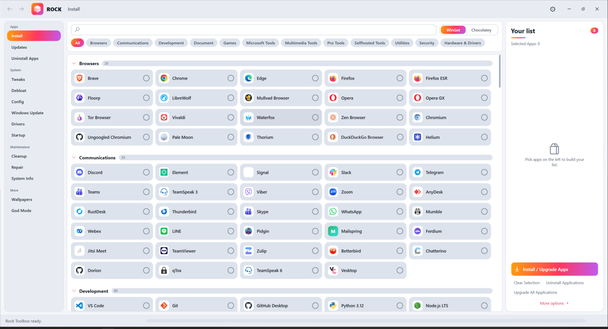

<div align="center">


# ROCK TOOLBOX

**One native Windows toolbox to install, tune, clean, repair and download.**

[](#requirements)
[](#requirements)
[](#project-structure)
[](https://github.com/OwnerRock/RockToolbox/releases)
[](#license)
[](https://github.com/OwnerRock/RockToolbox/releases)

[Download](https://github.com/OwnerRock/RockToolbox/releases) |
[Features](#features) |
[Install](#installation) |
[FAQ](#troubleshooting--faq)

<br>



</div>

---

## Table of contents

- [Features](#features)
- [Two looks: Classic and Modern](#two-looks-classic-and-modern)
- [All tools](#all-tools)
- [Drivers (new in 4.0.0)](#drivers-new-in-400)
- [Cleanup](#cleanup)
- [Installation](#installation)
- [Usage guide](#usage-guide)
- [Keyboard and tray notes](#keyboard-and-tray-notes)
- [Settings](#settings)
- [Where data is stored](#where-data-is-stored)
- [Troubleshooting / FAQ](#troubleshooting--faq)
- [Project structure](#project-structure)
- [Contributing](#contributing)
- [Credits](#credits)
- [Security notes](#security-notes)
- [License](#license)
- [بالعربي](#بالعربي)

## Features

| | |
|---|---|
| **Native and light** | Written in C# (WPF). No PowerShell is needed at runtime. |
| **Everything in one place** | Install apps, update them, remove them, tweak Windows, debloat, repair, clean and more. |
| **Drivers** | Scans your hardware and compares versions with the Microsoft Update Catalog. *New in 4.0.0* |
| **Two looks** | Classic (blue) or Modern (colourful gradient), light or dark. |
| **Languages** | English and Arabic (with RTL). More languages load from `lang/<code>.json`. |
| **Runs in the tray** | Closing the window keeps downloads going in the background. |
| **Single installer** | Built from one Inno Setup script, English and Arabic wizard, light/dark aware. |

## Two looks: Classic and Modern

* **Modern** is the default look in 4.0.0: colourful with gradients.
* **Classic** is the original blue look.

Pick the look in the first-run welcome window, or later in **Settings > Classic look**. Light and dark themes and accent colours work with both.

<div align="center">

</div>

## All tools

| Page | What it does |
|---|---|
| **Install** | App catalogue with icons, installs through winget / Chocolatey, Package ID install, Show Installed. |
| **Updates** | Winget upgrade for installed apps. |
| **Uninstall Apps** | Remove installed programs. |
| **Tweaks** | Windows tweaks, customisation, power plan, DNS. |
| **Debloat** | Remove built-in apps, plus OneDrive / Edge / Internet Explorer removers. |
| **Config** | Windows features, fixes, activation, SSH, cursors pack, shortcut. |
| **Windows Update** | Manage Windows Update. |
| **Drivers** | Scan and update drivers. *New in 4.0.0* |
| **Startup** | Manage startup programs. |
| **Cleanup** | Free disk space and show how much was really freed. |
| **Repair** | System repair tools. |
| **System Info** | Hardware and system details, with a live view. |
| **Wallpapers** | Search wallpapers, with a daily Bing wallpaper (small `RockToolboxDaily.exe` + scheduled task). |
| **God Mode** | Quick access to the God Mode control panel. |

## Download manager: now **R-Downloader**

**One file to publish:** `RockToolbox-Setup-4.1.0.exe` is the only setup. It installs Rock Toolbox and, if you tick **Install R-Downloader** on the Select Additional Tasks page, R-Downloader too (both are built together from this folder).

Since 4.1.0 the download manager is its own program, **R-Downloader** (multi-connection downloads, queues, torrents, Rlist playlists, browser extension). It is no longer inside Rock Toolbox. The Rock Toolbox installer has an optional task **Install R-Downloader** (built from the `RDownloader` folder together with Rock Toolbox, so you only build `installer/RockToolbox.iss`). R-Downloader 1.2 adds a menu bar (Tasks / File / Downloads / View / Help), an Options window with 11 tabs (proxy, site logins, per-server limit, virus scan, sounds, torrents...), an Add-torrent window, its own sounds, a new hexagon logo and a browser-cards extension window. R-Downloader 1.1 added smooth counters, a sound and an IDM-style "Download complete" window, a Grabber (collect the links of a web page), clipboard watching, an "after all downloads" action (close / sleep / shut down) and a paste-a-link box in the browser extension.

The setup also installs **winget (App Installer)** and **Chocolatey** quietly when they are missing. Put the 3 files listed in `redist/README.txt` in the `redist` folder before building. On its first start R-Downloader copies your look, language and download list from Rock Toolbox.

## Drivers (new in 4.0.0)

Rock Toolbox scans your hardware itself, compares the installed driver versions with the **Microsoft Update Catalog**, and shows each update as **"from X to Y"**. It does not use Windows Update: it reads the installed version and date from WMI, looks the hardware ID up in the Update Catalog, downloads the `.cab`, unpacks it with `expand.exe` and installs it with `pnputil`, after creating a restore point. Results are cached for a few hours in `driver-cache.json`.

## Cleanup

Cleans temporary and junk files and reports the **real freed space**.

## Installation

### Option 1: installer (recommended)
1. Open the [Releases](https://github.com/OwnerRock/RockToolbox/releases) page.
2. Download `RockToolbox-Setup-4.1.0.exe` and run it.
3. Choose English or Arabic, pick the options you want (desktop icon, taskbar pin, start with Windows, and the optional **R-Downloader**) and finish.

### Option 2: build from source
1. Install **Inno Setup 6.6 or newer** (6.6 gives the light/dark wizard).
2. Open `installer/RockToolbox.iss` in Inno Setup and press **F9** (Compile).
3. The setup is written to `out/RockToolbox-Setup-4.1.0.exe`.

The script compiles the program itself with the C# compiler built into Windows (`csc.exe`, .NET Framework 4) from `src/` and `daily/`. No Visual Studio or .NET SDK is needed. If it fails, read `%TEMP%\RockToolboxBuild\build.log` (a copy is saved as `build.log` in the project folder).

### Requirements
* Windows 10 or 11, 64-bit
* .NET Framework 4.x (included in Windows 10/11)
* Administrator rights (the app asks for them through its manifest)
* Internet access for installs, updates, downloads and drivers
* winget for the Install / Updates pages (Chocolatey is also supported)

## Usage guide

**Install apps**
1. Open **Install**, tick the apps you want.
2. Press the install button; winget or Chocolatey does the work. Use **Show Installed** to see what you already have.

**Update apps**: open **Updates** and run the winget upgrade.

**Remove apps**: open **Uninstall Apps**, select, uninstall.

**Update drivers**: open **Drivers**, let it scan, review the "from X to Y" list, then update.

**Free space**: open **Cleanup**, run it, and read the freed-space result.

**Tweak, debloat, repair**: use **Tweaks**, **Debloat**, **Repair**; each page explains its options before you apply them.

## Keyboard and tray notes

* Closing the window keeps Rock Toolbox running in the tray (next to the clock) so downloads continue. Tray menu: **Open**, **Run at startup**, **Exit**.
* Opening the app again while it runs in the background brings back the existing window.
* The settings page can turn off "stay in the background" and "run with Windows".
* The small shield on the icon is added by Windows because the app runs as Administrator.
* Command line: `--background` (start hidden), `--quit`, `--enable-startup`, `--disable-startup`, `--pin-taskbar`, `--unpin-taskbar`.
* Click anywhere outside the gear menu to close it.

## Settings

Open **Settings** (or the gear menu):

* Language (Arabic ready, others load from `lang/`)
* Light / dark theme
* Accent colours
* **Classic / Modern** look
* Background picture with opacity and blur
* Run with Windows, stay in the background
* Profile name and picture, export / import your selections

Theme, colour, language and look changes are applied by restarting the app automatically.

## Where data is stored

`%LOCALAPPDATA%\RockToolbox`

| File | Content |
|---|---|
| `settings.json` | Your settings |
| `error.log` | Errors, useful for bug reports |
| `icons/` | Cached app icons |
| `driver-cache.json` | Driver scan cache |

The uninstaller offers to delete this folder.

## Troubleshooting / FAQ

**"The remote name could not be resolved" (DNS error)**
Your DNS cannot resolve the address. Use **Fix DNS** in the app, or set Cloudflare DNS `1.1.1.1` yourself, then try again.

**Antivirus blocks or flags the app**
The app changes system settings and removes apps, so some antivirus tools are cautious. Build from source if you want to verify the code, or add an exception for the install folder.

**Something does not work**
Run Rock Toolbox **as administrator**. Many tweaks and installs need it.

**winget is missing**
Install or update **App Installer** from the Microsoft Store, then reopen Rock Toolbox. Chocolatey can be used instead.

**Where are the logs?** `%LOCALAPPDATA%\RockToolbox\error.log`.

## Project structure

```
RockToolbox/
├── src/
│   ├── Program.cs
│   ├── Core/            engine, theme, language, tray, download engine
│   ├── Data/            app catalogue and data tables
│   └── Pages/           one file per page (Install, Drivers, ...)
├── ui/                  XAML windows and styles
├── lang/                language files (ar.json)
├── daily/               RockToolboxDaily.exe, daily Bing wallpaper
├── assets/              icon and cursor pack
├── docs/images/         README images
├── installer/           RockToolbox.iss and Arabic.isl
├── out/                 setup output after compile
├── reference-powershell/ old PowerShell version (reference only)
├── app.manifest
├── MIGRATION.md
└── README.md
```

## Contributing

Issues and pull requests are welcome at [github.com/OwnerRock/RockToolbox](https://github.com/OwnerRock/RockToolbox).
1. Fork and create a branch.
2. Build with `installer/RockToolbox.iss` and test on Windows 10/11.
3. Describe what changed, and attach `error.log` lines for bug reports.

New languages: copy `lang/ar.json` to `lang/<code>.json` and translate it.

## Credits

* **OwnerRock**, author of Rock Toolbox.
* **SpotX** is a third-party script by [SpotX-Official](https://github.com/SpotX-Official). Rock Toolbox only runs it after you confirm.

## Security notes

* The app runs as Administrator; only run builds you trust.
* Third-party scripts (such as SpotX) run only after your confirmation.

## License

MIT (placeholder, add a `LICENSE` file before release).

---

## بالعربي

**Rock Toolbox** برنامج ويندوز مكتوب بـ C# (WPF) من غير PowerShell: تثبيت وتحديث وحذف برامج، تحسينات، Debloat، تنظيف، إصلاح، معلومات النظام، خلفيات وغيرها في مكان واحد.

الجديد في 4.1.0 و 4.0.0:
* **مدير التنزيلات** بقى برنامج مستقل اسمه **R-Downloader** (متاح كخيار في مثبّت Rock Toolbox).
* **Drivers**: بيفحص الجهاز ويقارن الإصدارات مع Microsoft Update Catalog ويعرض "من X إلى Y".
* شكلين: **Modern** و **Classic**.

التثبيت: نزّل ملف التثبيت من صفحة Releases، أو افتح `installer/RockToolbox.iss` في Inno Setup واضغط F9. شغّل البرنامج كـ Administrator. البيانات في `%LOCALAPPDATA%\RockToolbox`.
